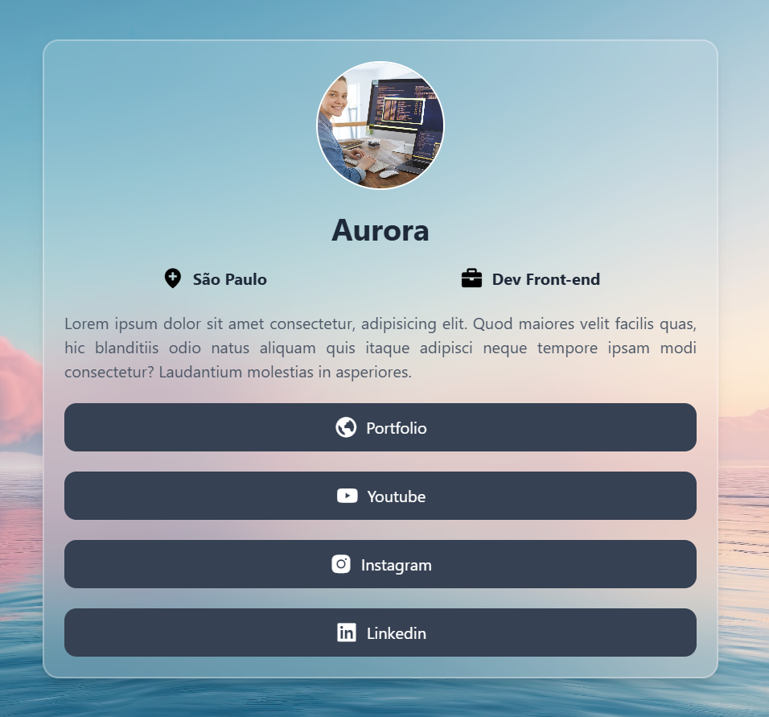

# Pagina-de-links

## Techs used

- `Html`
- `Css`
- `Tailwindcss`

## Getting started

- Faça o download desse repositorio
- Insale a extensão `Live Server`
- Abra o arquivo `index.html`

## Imagem

;
